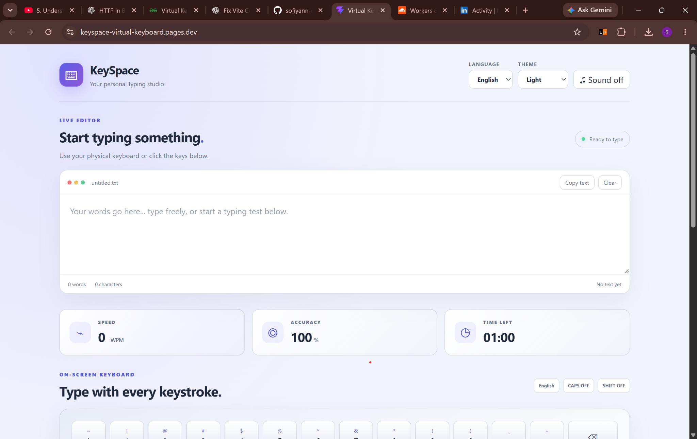
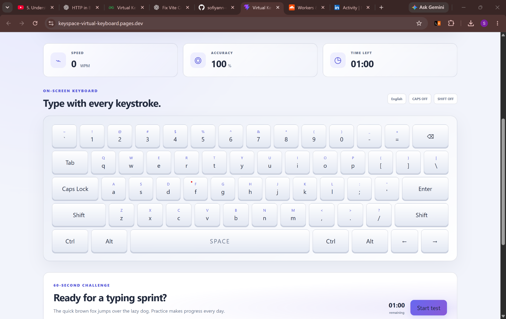
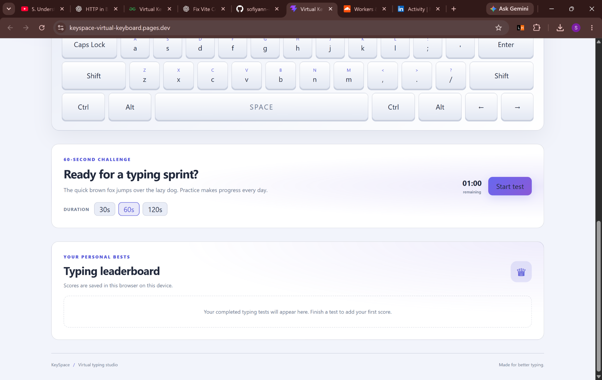

# KeySpace — Virtual Typing Studio

A clean, interactive virtual keyboard and typing-practice website built with React and Vite. KeySpace lets you type in a live editor, use an on-screen keyboard, switch languages and themes, and measure your typing performance with timed challenges.

🌐 **Live Demo:** https://keyspace-virtual-keyboard.pages.dev/

## Screenshots

### Live Editor and Typing Dashboard


### On-Screen Keyboard


### Typing Challenge and Personal Leaderboard


> **Add your screenshots:** Create a folder named `screenshots` in the repository and save your three screenshots with the filenames shown above. The screenshots in this README will display after those files are uploaded.

## Features

- **Live text editor** — type using your physical keyboard or the on-screen keyboard.
- **Interactive virtual keyboard** — click the keys to enter text.
- **Multiple languages** — choose from the available keyboard layouts, including English, Hindi, and Arabic.
- **Themes** — switch between Light, Dark, and Neon themes.
- **Sound control** — turn keyboard sound effects on or off.
- **Typing speed** — view typing speed in words per minute (WPM).
- **Accuracy tracking** — monitor typing accuracy during a challenge.
- **Timed typing tests** — choose a 30-, 60-, or 120-second challenge.
- **Personal leaderboard** — completed test scores are saved in your browser on your device.
- **Text utilities** — copy or clear the editor content.
- **Responsive interface** — a polished typing-studio layout for practicing on different screen sizes.

## Tech Stack

- React
- Vite
- JavaScript
- CSS
- Cloudflare Pages (deployment)

## Getting Started

### Prerequisites

Install a recent version of [Node.js](https://nodejs.org/) and npm.

### Run locally

1. Clone the repository:

   ```bash
   git clone https://github.com/sofiyann-codes/keyspace-virtual-keyboard.git
   ```

2. Move into the project directory:

   ```bash
   cd keyspace-virtual-keyboard
   ```

3. Install dependencies:

   ```bash
   npm install
   ```

4. Start the development server:

   ```bash
   npm run dev
   ```

5. Open the local URL printed in the terminal (Vite commonly uses `http://localhost:5173`).

### Build for production

```bash
npm run build
```

The production-ready files are generated in the `dist` directory.

## Deployment

The live website is hosted on Cloudflare Pages:

**https://keyspace-virtual-keyboard.pages.dev/**

If you connect the GitHub repository to Cloudflare Pages, configure the project with the appropriate build settings for Vite:

- **Build command:** `npm run build`
- **Build output directory:** `dist`

## Typing Test Notes

- The test supports **30, 60, and 120 seconds**.
- WPM and accuracy are shown in the dashboard.
- Personal scores are stored locally in the browser, so they are specific to the browser and device. They are not a shared online leaderboard.

## Contributing

Suggestions and improvements are welcome. To contribute:

1. Fork the repository.
2. Create a branch for your change.
3. Commit your changes.
4. Open a pull request.

## License

No license has been specified yet. Unless you add a license file, the project remains under the default copyright rules.
